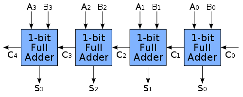
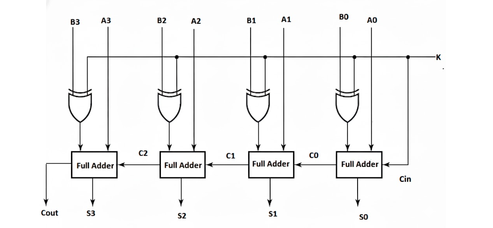

### Half Adder

A half adder adds two 1-bit binary numbers A and B to generate a 1-bit SUM (S) and a 1-bit CARRY (C) as output. The carry is theoretically carried on to the next bit position. The decimal equivalent of the sum of A and B numerically equals **2×C + S**. The simplest half-adder design, as shown in the above figure, incorporates an XOR gate for S and an AND gate for C.

#### Logic Equations

The outputs S and C can be expressed as logical functions of input variables A and B as follows:

**S = A ⊕ B** (XOR gate)

**C = A · B** (AND gate)

#### Key Features

- Simple design using only XOR and AND gates
- Adds two 1-bit numbers
- Produces sum and carry outputs
- Has no carry-in input, so it cannot add a carry coming from a lower bit position; on its own it can only be used for the least significant bit of a multi-bit adder
- Foundation for more complex adder circuits

#### Truth Table

| A   | B   | CARRY | SUM |
| --- | --- | ----- | --- |
| 0   | 0   | 0     | 0   |
| 0   | 1   | 0     | 1   |
| 1   | 0   | 0     | 1   |
| 1   | 1   | 1     | 0   |

#### Applications

- Basic building block for arithmetic circuits
- Simple calculator designs
- Educational demonstrations of binary addition
- Component in more complex adder designs

### Full Adder

A full adder adds two 1-bit binary numbers along with a carry generated from the previous addition and produces a sum and carry as outputs. A 1-bit full adder adds three 1-bit numbers, often written as A, B, and Cin, where A and B are the operands, and Cin is a bit carried in from a previous addition. The decimal equivalent of the sum equals **2×Cout + S**.

#### Logic Equations

**S = A ⊕ B ⊕ Cin**

**Cout = A · B + Cin · (A ⊕ B)**

#### Key Features

- Accepts three inputs: A, B, and carry-in (Cin)
- Produces sum (S) and carry-out (Cout)
- Can be cascaded to create multi-bit adders
- Essential building block for ripple carry adders
- More complex than half adder but more versatile

#### Truth Table

| A   | B   | Cin | Cout | S   |
| --- | --- | --- | ---- | --- |
| 0   | 0   | 0   | 0    | 0   |
| 0   | 0   | 1   | 0    | 1   |
| 0   | 1   | 0   | 0    | 1   |
| 0   | 1   | 1   | 1    | 0   |
| 1   | 0   | 0   | 0    | 1   |
| 1   | 0   | 1   | 1    | 0   |
| 1   | 1   | 0   | 1    | 0   |
| 1   | 1   | 1   | 1    | 1   |

#### Applications

- Multi-bit arithmetic operations
- Processor arithmetic logic units (ALUs)
- Digital signal processing systems
- Binary calculator circuits
- Computer arithmetic units

### Ripple Carry Adder

Multiple full adders can be used to create adders of greater bit lengths. Each full adder uses the Cout of the previous adder as its Cin. This kind of adder is called a ripple carry adder, since the carry bits "ripple" through the full adder stages from the LSB to the MSB. In the figure, the carry into the first stage is C₀ (the carry-in, Cin) and the carry out of the last stage is C₄ (the carry-out, Cout). If the carry-in C₀ is always 0, the first (and only the first) full adder may be replaced by a half adder.

#### Understanding Circuit Layout vs. Computational Flow

**Traditional Mathematical Notation**: Binary numbers are typically written with MSB (Most Significant Bit) on the left and LSB (Least Significant Bit) on the right, such as A₃A₂A₁A₀ for a 4-bit number.

**Computational Flow in Ripple Carry Adders**: However, the actual addition computation starts from the LSB and propagates toward the MSB. This is because:

- Addition begins with the rightmost (least significant) bits
- Any carry generated must propagate leftward to the next higher bit position
- The carry "ripples" from LSB→MSB (right to left in traditional notation)

**Layout in the Simulation**: The figure above and the Practice circuit board follow the written notation, with the LSB (A₀, B₀) on the right and the MSB (A₃, B₃) on the left, so the carry moves from right to left. The Demo draws the stages the other way round, with the LSB on the left and the MSB on the right, so that the carry can be followed from left to right on screen. The circuit is the same in both cases: the carry always moves from the LSB stage to the MSB stage.

#### Logic Equations

For a 4-bit ripple carry adder, each bit position has its own sum and carry equations. Stage i adds Aᵢ, Bᵢ and the carry Cᵢ coming into it, and produces the sum bit Sᵢ and the carry Cᵢ₊₁ going into the next stage. The carry into stage 0 is C₀ = Cin.

**Bit 0 (LSB):**

- S₀ = A₀ ⊕ B₀ ⊕ C₀
- C₁ = A₀B₀ + B₀C₀ + C₀A₀

**Bit 1:**

- S₁ = A₁ ⊕ B₁ ⊕ C₁
- C₂ = A₁B₁ + B₁C₁ + C₁A₁

**Bit 2:**

- S₂ = A₂ ⊕ B₂ ⊕ C₂
- C₃ = A₂B₂ + B₂C₂ + C₂A₂

**Bit 3 (MSB):**

- S₃ = A₃ ⊕ B₃ ⊕ C₃
- C₄ = A₃B₃ + B₃C₃ + C₃A₃

The result is C₄S₃S₂S₁S₀, that is, A₃A₂A₁A₀ + B₃B₂B₁B₀ + C₀ = 16·C₄ + 8·S₃ + 4·S₂ + 2·S₁ + S₀.

#### Key Features

- Each sum bit (S) is the XOR of the two input bits and the carry from the previous stage
- Each carry bit (C) is 1 when at least two of the three inputs of a stage (Aᵢ, Bᵢ, Cᵢ) are 1
- The carry "ripples" from the LSB stage to the MSB stage, which is why it is called a ripple carry adder
- A stage can produce its final outputs only after the carry from the previous stage has arrived
- For unsigned 4-bit numbers, the final carry C₄ = 1 means that the sum does not fit in 4 bits (overflow)
- Simple design but slower due to carry propagation delay: the delay grows linearly with the number of bits

#### Applications

- Multi-bit arithmetic in basic processors
- Simple calculator implementations
- Educational demonstrations of binary arithmetic
- Foundation for understanding faster adder designs
- Digital systems requiring multi-bit addition

### Adder-Subtractor Circuit

An adder-subtractor is a combinational circuit that can perform both addition and subtraction operations on binary numbers using the same hardware. This is achieved by utilizing the 2's complement method for subtraction.

#### Principle of Operation

**Addition Mode (M = 0)**: The circuit performs normal binary addition.
**Subtraction Mode (M = 1)**: The circuit performs A - B by computing A + (2's complement of B).

The 2's complement of a binary number is obtained by:

1. Finding the 1's complement (inverting all bits)
2. Adding 1 to the result

In the figure, the mode control input M is labelled K. In the Practice task, the CarryIn input bit is used as the mode control M.

#### Logic Equations

Using the same carry numbering as the ripple carry adder (Cᵢ is the carry into stage i), for each bit position i = 0, 1, 2, 3:

- **Modified B input**: B'ᵢ = Bᵢ ⊕ M
- **Sum/Difference**: Sᵢ = Aᵢ ⊕ B'ᵢ ⊕ Cᵢ
- **Carry**: Cᵢ₊₁ = AᵢB'ᵢ + Cᵢ(Aᵢ ⊕ B'ᵢ)
- **Initial Carry**: C₀ = M

Note that the figure labels the carries between the stages as C0, C1 and C2, counting the carry out of stage 0 as C0. In the equations above, these are C₁, C₂ and C₃.

For unsigned numbers in subtraction mode, the final carry C₄ = 1 means A ≥ B and S₃S₂S₁S₀ is A − B. C₄ = 0 means A < B; the result is then negative and S₃S₂S₁S₀ is its 2's complement.

#### Key Features

- Single circuit performs both addition and subtraction
- Uses XOR gates to conditionally invert B inputs based on mode control M
- Mode control line M selects between addition and subtraction
- When M = 0: B inputs pass through unchanged (B ⊕ 0 = B)
- When M = 1: B inputs are inverted (B ⊕ 1 = B'), and M provides the +1 for 2's complement
- Hardware efficient design using existing full adder logic

#### Truth Table for Operation Mode

| M   | Operation | Result                                 |
| --- | --------- | -------------------------------------- |
| 0   | A + B     | Sum = A + B                            |
| 1   | A - B     | Difference = A + (2's complement of B) |

#### Applications

- **Arithmetic Logic Units (ALUs)**: Essential component in processors
- **Digital Signal Processing**: Mathematical operations in DSP systems
- **Calculator circuits**: Basic arithmetic operations
- **Control systems**: Mathematical computations in embedded systems
- **Microprocessors**: Fundamental arithmetic operations in CPUs
